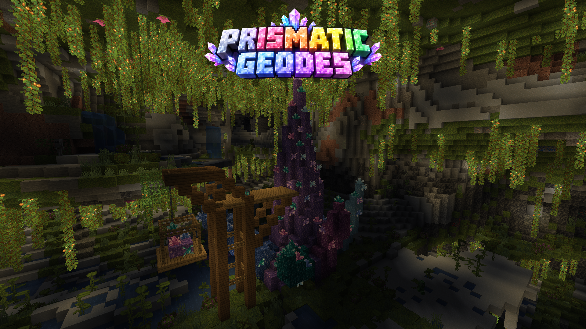
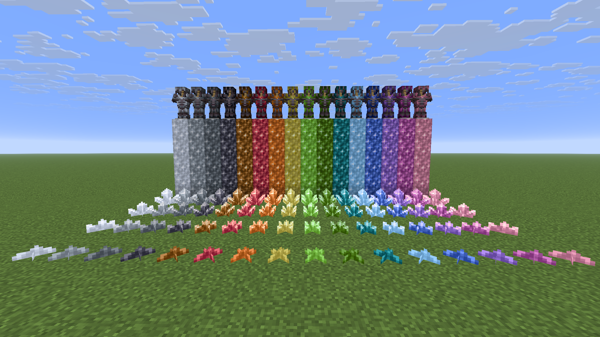
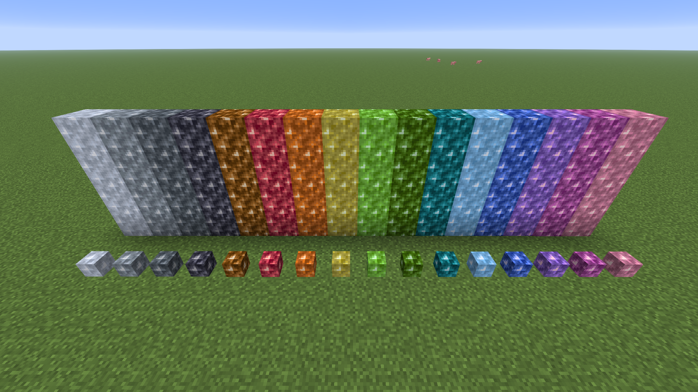
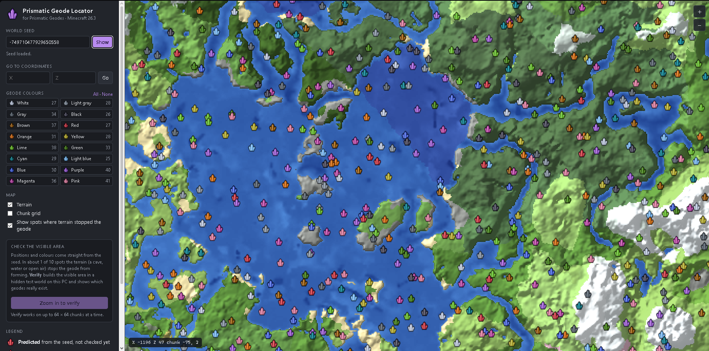

# Prismatic Geodes



**Prismatic Geodes adds amethyst geodes in all 16 Minecraft dye colours while keeping vanilla-like generation and
mechanics.**

A Fabric mod for Minecraft Java Edition 26.3. Two optional extras are released separately: the *Mini Blocks* addon
and the *Prismatic Geode Locator*, a free map tool that shows where each coloured geode is in your world.

> NOT AN OFFICIAL MINECRAFT PRODUCT. NOT APPROVED BY OR ASSOCIATED WITH MOJANG OR MICROSOFT.

**Download:** [Releases](https://github.com/KalleBoy39/prismatic-geodes/releases) ·
**Install:** [INSTALLATION.md](docs/INSTALLATION.md) ·
**Problems:** [TROUBLESHOOTING.md](docs/TROUBLESHOOTING.md) ·
**Report a bug:** [GitHub issues](https://github.com/KalleBoy39/prismatic-geodes/issues)

---

## What it does



### 16 colours, one colour per geode
Every amethyst geode picks one of the 16 dye colours: white, light gray, gray, black, brown, red, orange, yellow,
lime, green, cyan, light blue, blue, purple, magenta and pink. A geode is always a single colour, all the way through.

**Purple is plain vanilla amethyst.** Purple geodes are the same blocks and items you already know. The other 15
colours are complete amethyst families of their own.

### Vanilla rarity and placement
Geodes appear exactly as often, and in exactly the same places, as in vanilla. The mod only decides which colour each
geode gets, and every colour is equally likely (1 in 16). Nothing about caves, ores or other generation changes.

Only **newly generated chunks** get coloured geodes. Areas you have already explored keep their purple geodes.

### Growing crystals
Each colour has its own budding block. It grows small, medium and large buds and finally clusters **in its own
colour**, at the same speed and following the same rules as vanilla budding amethyst. Budding blocks still cannot be
picked up, not even with Silk Touch, just like in vanilla.

### Shards and crafting
- Clusters drop shards of their colour. Fortune, Silk Touch and tool rules work exactly like vanilla.
- **4 shards of one colour** craft into an amethyst block of that colour.
- Recipes that use amethyst shards (spyglass, tinted glass, calibrated sculk sensor) accept **shards of any colour**.

### Armour trims
Every shard colour is a trim material. Trim your armour at a smithing table with any colour you like, and it shows in
that colour on armour and on the armour item.

### Everything else stays vanilla
Same hardness, sounds, chimes, light and mining rules. The coloured blocks work with allays, vibrations and the other
vanilla behaviour of amethyst, and they show in their own colour on maps.

---

## Optional addon: Prismatic Geodes: Mini Blocks
**A separate, optional addon** with its own download (`prismatic-geodes-miniblocks-1.0.0+26.3.jar`). Prismatic
Geodes works fine without it.



It adds **mini blocks** (decorative heads) for the 15 coloured amethyst blocks. Put a coloured amethyst block in a
**stonecutter** to get 8 mini blocks.

It is made to sit naturally next to the **Vanilla Tweaks Mini Blocks** data pack: its head textures are based on,
and recoloured from, the Vanilla Tweaks Mini Amethyst Block. Purple is not added again, because Vanilla Tweaks
already has it (the purple one in the picture is the Vanilla Tweaks original). The addon also works without Vanilla
Tweaks. Requires Prismatic Geodes.

```
Credits:
Vanilla Tweaks: https://vanillatweaks.net/
```

## Optional tool: Prismatic Geode Locator
**A separate, optional Windows program** with its own download (`Prismatic-Geode-Locator-1.0.0-windows-x64.zip`).
It is not a mod and is not needed to play.



It opens a map in your browser. Enter your world seed and it shows:
- a terrain map of your world (land, water, biomes, mountains), computed from the seed,
- every geode with a small crystal icon in its colour,
- the exact coordinates, with buttons to copy them or a `/tp` command,
- filters for the colours you are looking for.

The positions and colours come straight from your seed, so they are exact. A button called **Verify visible area**
checks which spots really grew a geode, because terrain stops about 1 in 10 of them. It works by building that area in a
hidden test world on your own PC.

Nothing to install: download the ZIP, unzip, run. Java is included.

---

## Requirements

| | |
|---|---|
| Minecraft Java Edition | 26.3 |
| Mod loader | Fabric Loader 0.19.5 or newer |
| Fabric API | required (tested with 0.162.0+26.3) |
| Where | client **and** server |

The mod must be installed on the server *and* on every player's game. Realms does not support mods.

## Good to know before you add it to a world
- Only **new** chunks get coloured geodes. Explore new areas to find them.
- Once coloured blocks exist in your world, **the world needs the mod**. If you remove the mod later, coloured
  blocks turn into air and coloured items disappear. Purple (vanilla) amethyst is never affected.
- Make a backup of your world before adding any mod to it.
- Another mod or data pack that also changes the `minecraft:amethyst_geode` feature will conflict with this one.
  See [TROUBLESHOOTING.md](docs/TROUBLESHOOTING.md).

---

## Made something with Prismatic Geodes?
Built something cool, made an addon, changed the source or created something interesting with the project? Feel free
to DM me screenshots on Discord (**dubbelmonterad**). I'd genuinely like to see what people make with it.

Where things go:
- **Bugs:** [GitHub Issues](https://github.com/KalleBoy39/prismatic-geodes/issues), so others can find the answer later.
- **Code contributions and fixes:** [GitHub Pull Requests](https://github.com/KalleBoy39/prismatic-geodes/pulls)
  (see [CONTRIBUTING.md](CONTRIBUTING.md)).
- **Builds, screenshots, addons, forks, ideas and casual contact:** Discord.

Discord is just a friendly place to share things and say hi. It is not an official support channel, and you never
need it to report a problem.

## How this was made
Prismatic Geodes started as a personal project for my own Vanilla+ survival world. I wanted geodes in every dye colour
for building, without changing how Minecraft feels. I'm releasing it so other players can use the same idea without
having to build it themselves.

- **Concept, gameplay direction, visual decisions and testing:** KalleBoy39 (project author)
- **Implementation:** developed with extensive assistance from Claude Code, Anthropic's AI coding assistant.

To be clear about what that means: I did not hand-write all of the implementation myself. Most of the code, the
generated data and textures, the tests and the locator were written with Claude Code, following my direction. I decided
what it should do and how it should look, chose and approved every colour, and tested it in game.

Full credits: [CREDITS.md](CREDITS.md).

---

## For developers
- [How it works](docs/HOW-IT-WORKS.md): worldgen, growth, recipes, trims, files it overrides
- [Building from source](docs/BUILDING.md)
- [Contributing](CONTRIBUTING.md)
- Mod ID `vplus_geodes`, addon `vplus_geodes_miniblocks` (kept from the working title so existing worlds keep working)

## Licence
The **code** is open source under the [MIT License](LICENSE).

The MIT licence covers only the original code and project files written for Prismatic Geodes. It does **not** cover:
- textures and data derived from Minecraft (© Mojang / Microsoft),
- the Mini Blocks head textures derived from the Vanilla Tweaks Mini Amethyst Block (Vanilla Tweaks terms, credit
  required),
- the Java runtime bundled with the locator and other external dependencies (their own licences),
- the screenshots and logo/cover artwork in `docs/images/`.

Exactly which files fall under which terms: [THIRD-PARTY-NOTICES.md](THIRD-PARTY-NOTICES.md).
